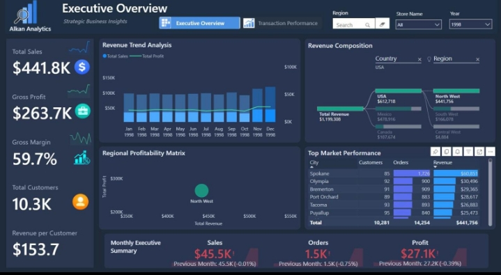

# HexSoftwares_Project_Name.
# PROJECT 01 – Sales Dashboard Analysis
Sales Dashboard Analysis in Excel / Power BI
# Click Link -> view raw -> Download in File 
https://github.com/sonu633/HexSoftwares_Project_Name./blob/main/Sales_Dashboard_Analysis.xlsx

# 1. Project Objective
Analyze sales data to understand revenue, profit, customer behavior, product performance, and regional sales trends.

# 2.KPI Cards
Total Revenue
Total Profit
Total Orders
Total Customers
Total Quantity Sold
Profit Margin (%)

# HexSoftwares_Project_Name.
This the most important project

# Data Analytics
Project List

# PROJECT - 02
HR Analytics Dashboard – Employee Attrition Analysis using Power BI
# Click Link -> view raw -> Download in File
https://github.com/sonu633/HexSoftwares_Project_Name./blob/main/hr_attrition_data.csv
https://github.com/sonu633/HexSoftwares_Project_Name./blob/main/HR_Attrition_Dashboard.xlsx

# PROJECT - 03
Student Performance Analysis
# Click Link -> view raw -> Download in File
https://github.com/sonu633/HexSoftwares_Project_Name./blob/main/Student_Performance_Analysis.xlsx
