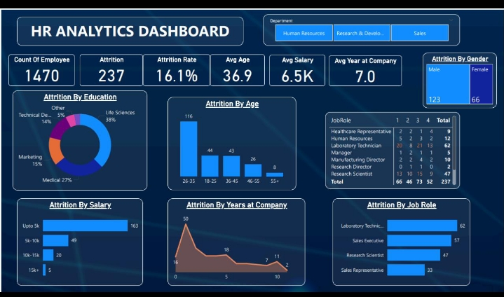
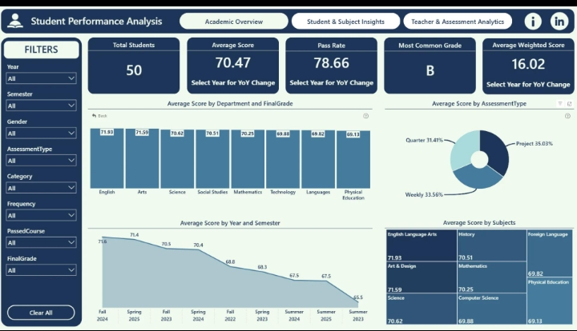

# HexSoftwares_Project_Name.
# PROJECT 01 – Sales Dashboard Analysis
Sales Dashboard Analysis in Excel / Power BI
# Click Link -> view raw -> Download in File 
https://github.com/sonu633/HexSoftwares_Project_Name./blob/main/Sales_Dashboard_Analysis.xlsx

# 1. Project Objective
Analyze sales data to understand revenue, profit, customer behavior, product performance, and regional sales trends.

# 2.KPI Cards
Total Revenue

Total Profit

Total Orders

Total Customers

Total Quantity Sold

Profit Margin (%)

# 3.Dashboard Charts
Attrition by Department

Attrition by Gender

Attrition by Age Group

Attrition by Job Role

Salary Distribution

# 4.Job Satisfaction Analysis
Interactive Features

Department Slicer

Gender Slicer

Age Group Filter

Job Role Filter

Attrition Status Filter

# PROJECT 02 – HR Analytics Dashboard
# Click Link -> view raw -> Download in File
https://github.com/sonu633/HexSoftwares_Project_Name./blob/main/hr_attrition_data.csv
https://github.com/sonu633/HexSoftwares_Project_Name./blob/main/HR_Attrition_Dashboard.xlsx

# 1. Project Objective
Analyze employee attrition and identify factors affecting employee turnover to support HR decision-making.

# 2.KPI Cards
Total Employees

Attrition Count

Attrition Rate (%)

Average Salary

Average Age

Active Employees

# 3.Dashboard Charts
Attrition by Department

Attrition by Gender

Attrition by Age Group

Attrition by Job Role

Salary Distribution

Job Satisfaction Analysis

# 4.Interactive Features
Department Slicer

Gender Slicer

Age Group Filter

Job Role Filter

Attrition Status Filter

# PROJECT 03 – Student Performance Analysis
# Click Link -> view raw -> Download in File
https://github.com/sonu633/HexSoftwares_Project_Name./blob/main/Student_Performance_Analysis.xlsx

